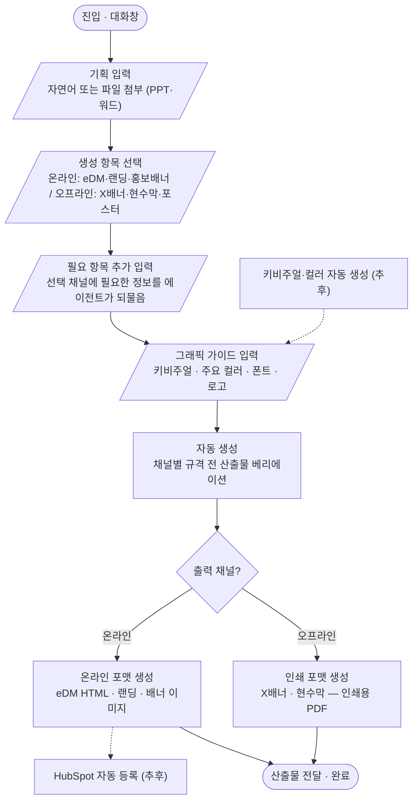

# MBM 캠페인 디자인 실행 에이전트 — 제품화 개념 문서

> 2026-08-10 그릴 인터뷰로 확정한 제품화 결정 사항.
> 설계 기준은 **최종상**이며, 파일럿은 그 부분집합이다.

## 1. 한 줄 정의

MBM 기획 확정 후, 하나의 Campaign Context와 Design Direction으로
eDM·Landing·광고 배너·SNS·오프라인 제작물을 자동 생성·베리에이션하고
HubSpot 등록과 인쇄용 파일까지 연결하는 대화형 에이전트.

**디자이너의 전환**: N개 결과물을 각각 디자인하는 사람
→ 하나의 캠페인 디자인 시스템을 설계하고 AI로 확장하는 사람.

## 2. 4관점 가치

### 마케터 (요청자)
- **요청→시안 리드타임 당일화**: 요청서 작성→대기→시안→수정 왕복이 "브리프 입력→초안 확인"으로 압축
- **변경 전달 1회**: 일정·연사·장소 변경을 한 번 말하면 전 산출물 반영 — 산출물별 수정 요청 반복 소멸
- **실행까지 직결**: eDM·Landing이 HubSpot에 바로 등록 — 확정 후 발송 준비 시간 최소화
- **채널 실험 자유**: 규격 추가 비용이 0에 수렴 — 디자이너 리소스 때문에 포기하던 채널 시도 가능

### 디자이너
- **반복 제작 제거**: 규격 전개·재배치 작업이 사라져 투입 시간 60% 회수 → Direction·품질 판단에 재투자
- **수정 지옥 탈출**: 일괄 반영 + 수정 누락 리스크 소멸 — "찾아서 고치고 다시 확인"이 없어짐
- **직무 격상**: 오퍼레이터 → 캠페인 디자인 시스템 설계자. 판단하는 일만 남음
- **노하우의 자산화**: 캠페인 스타일이 프리셋 서랍에 쌓여 개인 감각이 재사용 가능한 조직 자산이 됨

### 사업 (사업부)
- **행사 준비 기간 단축**: 캠페인 디자인이 병목에서 빠짐 — 기획 확정이 늦어도 실행 가능
- **운영 리스크 감소**: 연사 교체·장소 변경에 즉시 대응, 채널 간 구정보·오탈자 노출 사고 방지
- **캠페인 처리량 확대**: 디자인 대기열 해소로 MBM 개최 빈도·동시 진행 수 확장 가능
- **정보 일관성 보증**: 모든 채널이 하나의 Campaign Context를 바라봄 — 채널마다 다른 정보가 원천 차단

### 법인 (전사)
- **증원 없는 물량 확장**: 디자인 리소스 추가 없이 캠페인 수를 늘리는 비용 구조
- **소모품 → 자산**: 1회성으로 버려지던 캠페인 디자인이 Campaign Style·프리셋·로그로 축적되는 시스템 자산화
- **제작 데이터 가시화**: KPI 자동 로그가 캠페인별 제작 비용·처리량·리드타임을 경영 지표로 전환
- **복제 가능한 AX 모델**: 디자인 직무 AX 성공 사례 — MBM 외 행사·타 직무·해외법인 로컬 캠페인으로 수평 확산

## 3. 제품 형태

- **대화창에서 시작하는 에이전트.** PPT·워드·자연어 무엇이든 대화창에 던지면 시작.
- 화면(보드)은 결과 확인·편집을 위한 보조 수단. 형태 논의는 개발 단계에서.

### 전체 플로우

### 디자인 자산 검색 플로우 (자산 재사용)

자연어 질문("작년 온사이트 출시 MBM 배너 찾아줘") → AI가 검색 조건 해석(연도·브랜드·산출물) → 시스템이 필터 서칭(매칭 프로젝트+유사 자산) → 사람이 미리보기 확인(아니오면 조건 바꿔 재검색) → 원본 접근(다운로드·Figma·NAS) → 재사용 완료.
과거 캠페인 산출물·프리셋 서랍이 검색 대상 — 축적 자산의 재사용 진입점.

### 고객 플로우 (인터랙션 수준)

1. **시작** — 기획서.pptx 드래그 + "다음 달 MBM 캠페인 시작할게" → Context 카드 표시·빈칸 질문 → 답 입력 → 산출물 체크박스 선택 → 채널별 추가 항목 질문
2. **Direction** — 키비주얼 업로드 + 무드·컬러 지시 (또는 [프리셋 서랍], 추후 [AI로 3안]) → Campaign Style 미리보기 → [확정] 클릭
3. **생성·리뷰** — 전 산출물 그리드 미리보기 → 대화로 일괄 지시 + 개별 직접 편집 → [전체 승인]
4. **실행** — 이메일 호환 HTML·랜딩 패키지 · 배너 zip · 인쇄 PDF 다운로드 (추후: HubSpot Draft 자동 등록)
5. **변경 대응** — "장소 변경됐어" 입력 → 영향 산출물 목록(손 편집 표현 유지 표기) → [일괄 반영] → 재승인

## 4. 확정 결정 사항

### 입력 · Campaign Context

| # | 결정 | 내용 |
|---|------|------|
| 1 | 입력 형태 | PPT / 워드 / 자연어 모두 허용. 대화창이 유일한 입구 |
| 2 | 스키마 방식 | **산출물 선택이 스키마를 결정.** 공통 코어 필드(행사명·일시·장소·CTA)는 항상, 채널별 필드(eDM=발신정보·제목, Landing=등록 폼 항목, Poster=인쇄 사양)는 선택한 산출물에 따라 추가 수집 |
| 3 | 빈칸 처리 | 추측 금지. 빈칸은 Agent가 되물음 — 최종상에선 요청자(사업/마케팅)에게 직접, 파일럿에선 디자이너에게 질문 리스트로 |

### Design Direction

| # | 결정 | 내용 |
|---|------|------|
| 4 | 브랜드 제약 | 캠페인마다 자유. 고정 브랜드 레이어 없음 |
| 5 | Direction 입력 3경로 | ① **디자이너 제공(기본)**: 키비주얼 + 컬러 + 폰트 + 로고 업로드 ② **AI 생성**(추후 확장): Direction 텍스트로 키비주얼·컬러 생성 ③ **탑재 프리셋**: 축적된 스타일 세트에서 선택 |
| 6 | 정규화 | 3경로 모두 동일한 **Campaign Style** 구조(키비주얼·컬러·타이포·무드 키워드)로 정규화. 전개 엔진은 하나. 캠페인 스타일은 완료 후 프리셋 서랍에 축적 |

### 생성 · 산출물

| # | 결정 | 내용 |
|---|------|------|
| 7 | 산출물 구조 | 산출물 = 키비주얼(이미지) + 레이아웃·텍스트(코드 렌더). HTML로 렌더 후 채널별 변환: eDM=이메일 호환 HTML, 배너·SNS=이미지, 포스터·X-banner=인쇄용 PDF |
| 8 | 비율 대응 | 키비주얼 1장 → 가로 배너·세로 포스터·정방 SNS 전개 시 "안전 크롭 + 색면 배경 확장" 규칙(코드 처리). AI 아웃페인팅은 2차 확장 |

### 수정 · 변경 전파

| # | 결정 | 내용 |
|---|------|------|
| 9 | 수정 방식 | 둘 다. **대화 지시** = Direction 수준 수정(전 산출물 일괄 반영), **직접 편집** = 개별 예외 처리 |
| 10 | 전파 규칙 | **정보는 시스템 소유, 표현은 디자이너 소유.** Context 정보(장소·일시·Speaker)는 전파가 갱신, 디자이너가 만진 스타일·레이아웃은 유지. 같은 필드 충돌 시 목록 띄우고 확인 |

### 실행 · 연동

| # | 결정 | 내용 |
|---|------|------|
| 11 | HubSpot | **단계형.** 1차 = 실행 포맷 파일 생성(이메일 호환 HTML·랜딩 패키지)까지. 확장 = HubSpot API 자동 등록(eDM Draft + Landing Pages) |
| 12 | 배너·SNS | 파일 납품까지. 광고 플랫폼(Google Ads 등) 등록은 범위 밖 |

### 역할 · 측정

| # | 결정 | 내용 |
|---|------|------|
| 13 | 역할 모델 | 2역할 — **요청자**(사업/마케팅: 브리프 입력·정보 변경)와 **디자이너**(Direction·승인·예외 편집). 모든 산출물 확정에 **디자이너 승인 게이트** 필수 |
| 14 | KPI 로그 | 도구가 자동 기록: 캠페인별 산출물 수·Variation 수·수정 지시·재생성 횟수·리드타임. 디자이너 투입 시간만 수동. 이 로그가 최종상에선 운영 대시보드가 됨 |

## 5. 파일럿 vs 최종상

| 항목 | 파일럿 (4~6주) | 최종상 |
|------|---------------|--------|
| 사용자 | 디자이너 단독 | 요청자 + 디자이너 (승인 게이트) |
| 산출물 | eDM · Landing · Google 배너 2~3규격 · Poster/X-banner 1~2종 | 전 채널 (SNS·PPT·Signage 포함) |
| Direction | 디자이너 제공 경로 중심 | 3경로 전부 + 프리셋 서랍 축적 |
| 실행 연동 | 실행 포맷 파일 생성 (수동 등록) | HubSpot API 자동 등록 |
| 검증 | 직전 MBM 재현 → 예정 MBM 실전 투입 | 상시 운영 |
| 측정 | KPI 실측 (제작시간·AI 수행률) | 운영 대시보드 |

## 6. KPI

1. **MBM 캠페인 디자인 제작시간** — 60% 이상 단축. 기획 확정→산출물 완료까지 디자이너 실투입 시간
2. **반복 디자인·Variation AI 수행률** — 80% 이상. 분모 = 산출물 종수 × 채널별 규격 수

Baseline: 파일럿 전 1주 신규 측정 + 직전 MBM 1건 회고 측정 병행.

## 7. 확인 필요 · 리스크

- [ ] HubSpot API 토큰 발급 (관리자·요금제 확인 — Marketing Hub Professional 이상)
- [ ] 예정 MBM 날짜 확정 → 개발 일정 역산
- [ ] 직전 MBM 기획자료 샘플 확보 (Context 스키마 역설계 + 재현 테스트 데이터)
- [ ] 이메일 클라이언트 호환 HTML (테이블 레이아웃·인라인 CSS·이미지 호스팅) — 기술 리스크 최대 지점
- [ ] 인쇄 사양 확정 (재단 여백·해상도·인쇄소 요구 포맷)

## 8. 코드 전략

onsite-web-generator에서 **선별 이식** — 팩 계약 개념(토큰 정규화), llm 호출 패턴, 렌더러 패턴만 가져오고 캠페인 모델(Context → Style → 멀티채널 Variation)에 맞는 구조로 새로 설계. 통째 포크 금지.
